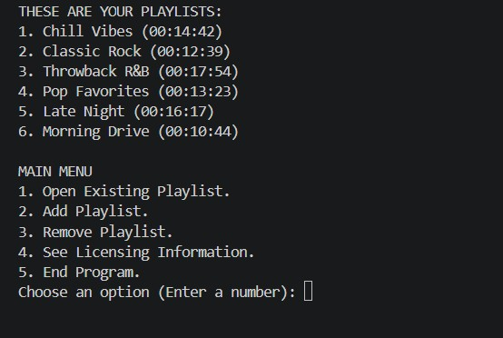
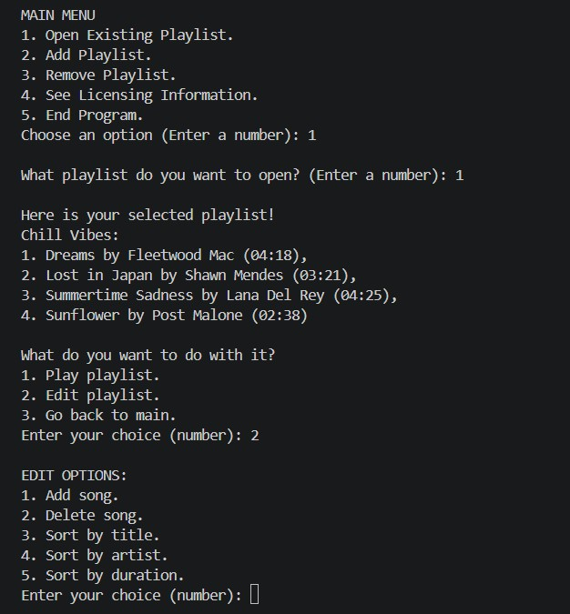
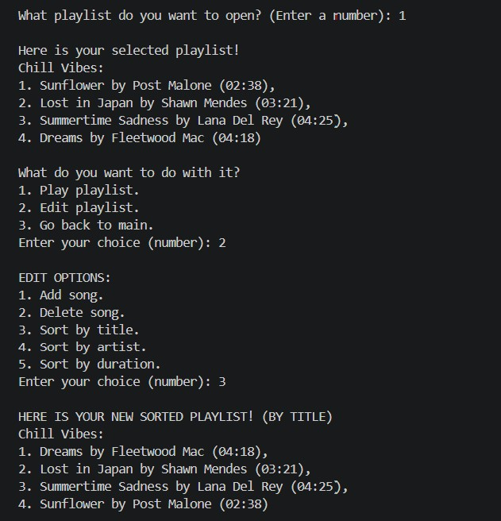

# Java Playlist Manager

A Java console application for organizing playlists and song information. Originally developed in 2024 as a college programming final project, it was later revisited to improve readability, organization, and input handling while keeping its original scope.

The project demonstrates core Java programming through a menu-driven application with local file storage.

## Features

- Create, view, and remove playlists.
- Add and delete songs with a title, artist, and duration.
- Sort songs by title, artist, or duration, with tie-breaking rules for title and artist sorting.
- Display each playlist's total duration.
- Simulate playing the songs in a playlist.
- Validate numeric menu choices and song durations.
- Prevent songs by predefined restricted artists from being added.
- Load playlists at startup and save after changes and when exiting through the menu.

## Technologies Used

- Java and the Java Development Kit (JDK).
- Standard Java collections, comparison interfaces, console input, and file I/O.
- Optional VS Code configuration for compiling and launching the application.

No external libraries, frameworks, or build-tool dependencies are required.

## Getting Started

### Prerequisites

Install a JDK, not just a Java runtime, and make sure `java` and `javac` are available in your terminal:

```text
java -version
javac -version
```

Requires Java 11 or later. Compilation and console workflows were checked with JDK 21.0.1.

### Download and Run

1. Use GitHub's **Code > Download ZIP** option and extract the project, or clone it using the repository's URL.
2. Open a terminal in the project root: the directory containing `src/`, `README.md`, and `Playlists.txt`.
3. Compile the Java files:

   ```text
   javac -d bin src/project02i4/*.java
   ```

4. Start the application from that same directory:

   ```text
   java -cp bin project02i4.Project02i4
   ```

The included `Playlists.txt` contains sample playlists and also serves as the application's saved data. Changes overwrite this file, so keep a copy if you want to preserve the samples. The program looks for it in the current working directory; running elsewhere uses a different location. If the file is missing, the application starts with an empty collection and creates it on a successful save.

## How It Works

The main menu lists playlists and their total durations. Enter a menu number to open, add, or remove a playlist, view the simulated licensing information, or end the program.

For example:

1. Choose **Add Playlist** and enter a name such as `Study Mix`.
2. Open that playlist, choose **Edit playlist**, then **Add song**.
3. Enter a title, artist, and duration such as `03:45`.
4. Open the playlist again and choose an edit option to sort its songs.
5. Choose **Play playlist** to print a playback message for each song.
6. End the program and restart it to see the saved playlists.

Most actions return to the main menu. Adding and deleting songs offer an option to continue with another song.

## Screenshots

### Main Menu



### Playlist Management



### Sorting by Title



## Project Structure

All Java source files are in `src/project02i4/`.

| Class | Responsibility |
| --- | --- |
| `Project02i4` | Starts the application. |
| `PlaylistApplication` | Displays menus, reads input, and coordinates changes and saves. |
| `Song` | Stores song details, validates durations, and defines equality and duration ordering. |
| `Playlist` | Manages songs, sorting, total duration, and conversion to and from saved text. |
| `PlaylistOfPlaylists` | Manages the collection of playlists and its text representation. |
| `IOHandling` | Reads and writes the playlist data file. |
| `CompSongByTitle` | Compares songs by title, then artist, then duration. |
| `CompSongByArtist` | Compares songs by artist, then title, then duration. |

`bin/` holds compiled classes and is excluded from Git. `.vscode/` contains optional editor and launch settings.

## Programming Concepts Demonstrated

- **Object-oriented programming:** private fields, methods, and composition of songs into playlists.
- **Collections and generics:** typed `List` and `ArrayList` collections, loops, and safe removal with an iterator.
- **Interfaces and sorting:** `Comparable<Song>` for duration ordering and `Comparator<Song>` for multi-field sorting.
- **Object methods:** overriding `equals`, `hashCode`, and `toString`.
- **File handling:** buffered text I/O, parsing, and try-with-resources.
- **Validation and exceptions:** numeric menu checks, regular expressions for durations, and handling invalid input and I/O exceptions.
- **Basic algorithms:** linear searches and accumulating song durations.

## Limitations

- **Simulated playback:** Playing a playlist prints console messages; no audio files are played.
- **Simple local storage:** Playlists are saved in a single text file without automatic backups. Names, titles, and artists should not contain commas or line breaks, which the format cannot handle.
- **Predefined artist restrictions:** A fixed list of artist names is matched exactly, including capitalization and spaces. Restricted songs loaded from a file are removed on the next save. This is a simulated rule, not a real licensing system.
